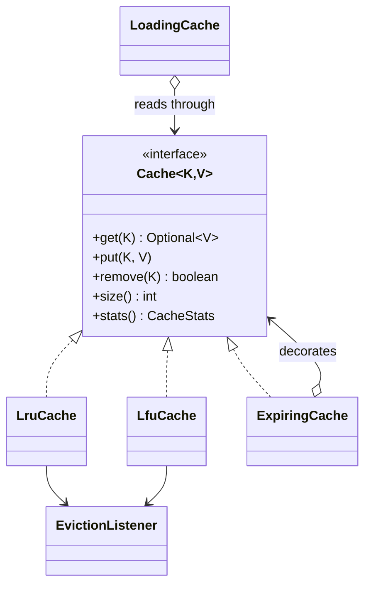

# LRU & LFU Cache

In-memory caches written from scratch in Java 21: LRU, O(1) LFU, a TTL decorator and a read-through loading cache that prevents cache stampedes.

The LRU and LFU questions come up in almost every backend interview. I wanted versions that go past the textbook answer - thread safety, eviction callbacks, stats, expiry, and what happens when a hot key expires under load.

## What's in here

| Class | What it does |
|---|---|
| `LruCache` | HashMap + hand-written doubly linked list, O(1) get/put |
| `LfuCache` | O(1) LFU using frequency buckets and a `minFrequency` pointer, LRU tie-breaking |
| `ExpiringCache` | Decorator that adds TTL on top of any `Cache` |
| `LoadingCache` | Read-through cache, loads each missing key once even with many concurrent callers |
| `CacheStats` | Hits, misses, evictions, hit rate |

## Design



### LRU

```
head <-> [most recent] <-> ... <-> [least recent] <-> tail
```

`get` moves the node to the front, `put` on a full cache drops `tail.prev`. Sentinel head/tail nodes remove all the null checks from the list code.

### LFU in O(1)

The naive LFU scans for the smallest counter on every eviction (O(n)) or keeps a heap (O(log n)). Here:

- `entries: key -> (value, frequency)`
- `keysByFrequency: frequency -> LinkedHashSet<key>` (insertion order = recency inside that frequency)
- `minFrequency`: the bucket to evict from

On access a key moves from bucket `f` to `f+1`; if bucket `f` becomes empty and was the minimum, `minFrequency` moves up. New keys always go to bucket 1 and reset `minFrequency` to 1. Everything is O(1).

### Cache stampede protection

When a popular entry expires, every request misses at the same moment and they all hit the database. `LoadingCache` keeps a map of in-flight loads (`key -> CompletableFuture`). The first thread to miss does the load; the others `join()` the same future. Failed loads aren't cached, so the next call retries.

`ExpiringAndLoadingCacheTest#loaderRunsOnceForConcurrentMissesOnSameKey` proves it: 10 threads, 1 loader call.

## Thread safety

- Both caches use a single `ReentrantLock`. Even reads change state (recency or frequency), so a read/write lock gives no benefit.
- Eviction listeners are called **after** releasing the lock, so a slow listener can't stall the cache.
- Stats use `LongAdder`, which scales better than `AtomicLong` when many threads increment it.

## When LRU vs LFU

The demo replays a skewed workload (80% of reads on 15 hot products) with a periodic burst of one-off "cold" reads:

```
LRU -> hits=13649 misses=6351 evictions=6631 hitRate=68.2%
LFU -> hits=16021 misses=3979 evictions=4259 hitRate=80.1%

20 concurrent requests for the same user -> DB calls: 1
```

LRU gets polluted by the scan because recent = valuable to it. LFU keeps the hot items since they've built up frequency. The flip side: LFU adapts slowly when popularity changes (yesterday's hot item hangs on). Production caches like Caffeine use W-TinyLFU to get the best of both.

## Running

```bash
mvn test
mvn compile && java -cp target/classes com.praveen.cache.Demo
```

## Possible improvements

- Lock striping / segmented cache to reduce contention on one lock
- Background sweep of expired entries (right now they're removed lazily on read)
- Frequency aging in LFU so old popularity decays over time
- Size-based eviction by weight instead of entry count
